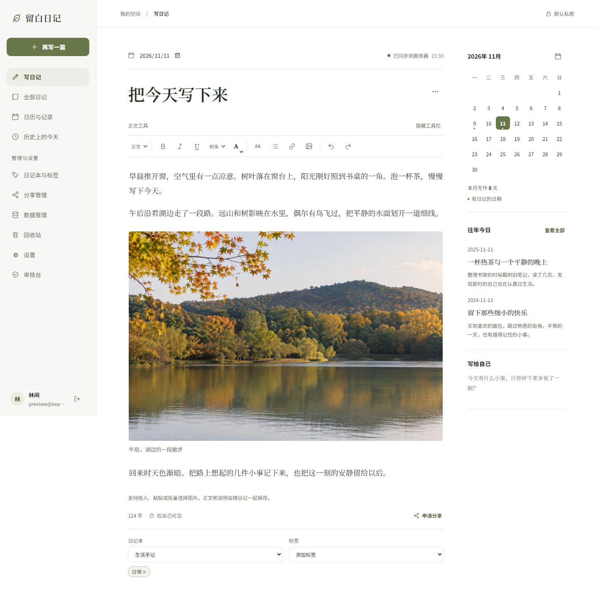

# 留白日记

留白日记是一款面向个人长期记录的中文日记 Web 应用。日记默认私密，支持图文写作、日记本与标签、离线草稿、历史回顾，以及可控的分享和数据迁移。

## 界面预览



[查看手机端写作页面](docs/screenshots/mobile-write-light.png) · [查看全部运行截图与说明](docs/screenshots/README.md)

## 功能概览

- **私密写作**：按日期创建多篇日记，支持富文本、图片、日记本、标签、标题和正文检索。
- **离线与自动保存**：本地草稿和离线编辑队列基于 IndexedDB 保存；联网后同步，并在版本冲突时保留本地内容供用户处理。
- **整理与回顾**：日历、写作活动统计、连续天数、热力图、往年同日回顾，以及带来源的“历史上的今天”。
- **受控分享**：作者提交固定内容快照，经管理员审核后以只读方式分享；分享支持有效期和撤销，普通日记保存不进入审核流程。
- **数据迁移**：支持 Markdown ZIP 导入、HTML/PDF 阅读版导出、完整备份与追加恢复，以及 15 天回收站。
- **账号与提醒**：邮箱验证、密码重置、会话管理；邮件提醒和 Web Push 可分别配置。
- **个性化界面**：桌面与手机布局、浅色/深色主题和强调色设置。

## 技术栈

| 部分 | 技术 |
| --- | --- |
| 前端 | Vue 3、TypeScript、Vite、Tiptap、IndexedDB、Service Worker |
| 后端 | Java 17、Spring Boot、Spring Security、MyBatis |
| 数据与迁移 | MySQL 8.x、Flyway |
| 媒体与消息 | 本地私有媒体目录、SMTP、Web Push |

后端使用服务端会话和 HttpOnly Cookie，写请求通过 CSRF 保护；数据访问在服务端校验用户归属。数据库迁移由 Flyway 管理，日记媒体存放在独立目录。更多组件边界和数据流见[架构说明](docs/architecture.md)。

## 环境要求

- JDK 17 或更高版本
- Node.js 20.19+ 和 npm
- MySQL 8.x 独立实例或独立 schema

项目包含 Maven Wrapper，无需预装 Maven。首次运行时需要联网下载 Maven 3.9.16 和项目依赖。不要将本项目连接到存有其他应用数据的数据库。

## 本地启动

### 1. 创建专用数据库

检查 [`db/create-database.sql`](db/create-database.sql)，先将示例密码替换为随机强密码，再由有权限的数据库管理员在专用 MySQL 实例执行。该脚本只用于创建本项目的 `liubai_diary` schema 和 `liubai_app` 数据库账号。

### 2. 配置后端

PowerShell 示例：

```powershell
$env:SPRING_DATASOURCE_PASSWORD = '<liubai_app 数据库密码>'
$env:APP_ADMIN_EMAIL = 'admin@example.com'
$env:APP_ADMIN_USERNAME = 'admin'
$env:APP_ADMIN_PASSWORD = '<新设管理员密码>'
$env:APP_ADMIN_NICKNAME = '演示管理员'
```

需要邮箱验证、密码重置或邮件提醒时，还需配置 SMTP 变量。普通用户注册邮件流程在 SMTP 未配置时不可用。所有可配置项见[部署说明](docs/deployment.md)和[根目录 `.env.example`](.env.example)。Spring Boot 不会自动读取 `.env` 文件，请在终端、IDE 运行配置、容器 secret 或服务管理器中设置变量。

### 3. 启动后端

在项目根目录运行：

```powershell
.\mvnw.cmd spring-boot:run
```

后端默认监听 `http://localhost:8080`。首次启动时，Flyway 会在 `liubai_diary` 中应用数据库迁移。媒体文件默认保存在 `./var/media`。

### 4. 启动前端

新开终端运行：

```powershell
cd frontend
npm ci
npm run dev
```

打开 `http://localhost:5173`。Vite 开发服务器会将 `/api` 请求代理到本地后端。

## 生产部署提示

执行 `npm run build` 生成 `frontend/dist`，由 Web 服务器发布静态页面，并将 `/api` 反向代理到 Spring Boot。生产环境应启用 HTTPS，将 `APP_MEDIA_ROOT` 指向持久化磁盘，并将数据库与媒体目录纳入同一备份策略。邮件、Web Push 和管理员初始化变量需按部署环境配置。

完整步骤、变量清单和故障排查见[部署说明](docs/deployment.md)。

## 项目文档

- [需求与完成度](docs/requirements.md)
- [架构说明](docs/architecture.md)
- [部署说明](docs/deployment.md)
- [关键代码与实现原则](docs/key-code-and-principles.md)
- [验证记录](docs/test-report.md)
- [演示脚本](docs/demo-script.md)
- [运行截图说明](docs/screenshots/README.md)
- [依赖与许可证](docs/dependency-licenses.md)

SMTP 和 Web Push 依赖外部服务配置；生产环境的 HTTPS、反向代理和持久化存储也需由部署方提供。当前验收范围和已知边界记录在[验证记录](docs/test-report.md)中。
