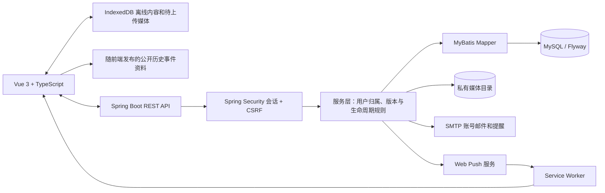

# 架构说明

## 组件边界

前端页面在 `frontend/src/features`，通用编辑器、图标和阅读组件在 `frontend/src/components`。`lib/api.ts` 集中处理 JSON/会话请求，`lib/offline.ts` 管理按账号隔离的 IndexedDB 草稿与上传队列。Vite 开发服务器将 `/api` 代理到后端。

后端以 `com.liubai.diary` 为根包。Controller 负责 HTTP 请求和身份，Service 承担事务与业务约束，Mapper 执行 MyBatis SQL。Flyway 版本化创建 schema。`app_users`、`journals`、`media_assets`、`share_requests`、`share_links` 与连接表是主要实体。原始媒体写入用户隔离目录，MySQL 保存元数据与哈希。

## 身份与数据访问

使用 Spring Security 服务端会话和 HttpOnly Cookie；写请求带 CSRF Token。密码由 BCrypt 编码，邮箱令牌只保存哈希并设置过期和一次性使用。环境变量管理员初始化只允许首次创建，不把普通用户提升为管理员。

日记、媒体、日记本、标签和数据接口都从会话主体取得 owner ID；客户端传入的对象 ID 不能改变归属。分享读取仅根据有效令牌读取已批准快照，用户私有日记不随当前编辑内容变化。媒体接口在服务层再次验证所有者或对应的批准分享。

## 一致性和生命周期

日记使用版本号进行乐观并发控制。写入遇到版本不一致时返回冲突及服务器版本；前端保留 IndexedDB 本地内容，提示用户处理，不静默覆盖。写作活动按照正文变更的本地日期去重；日期覆盖统计由日记实际日期单独计算。

删除日记先进入回收站，恢复不会复活已撤销的分享链接。调度任务定期清理删除超过 15 天的记录及不再被正文引用的媒体。永久删除账号的完整验收尚未完成。

导入批次 ID 与恢复映射用来跳过已处理记录；恢复过程以追加为主，对标题冲突创建副本。导入器的复杂标题和越界 ZIP 路径仍需要独立样本验证，详见 [验证记录](test-report.md)。

## API 入口

- `/api/auth/*`：CSRF、当前用户、注册、验证、登录、登出和密码重置。
- `/api/journals/*`、`/api/library/*`：日记与资料库。
- `/api/media/*`：需要用户身份的私有媒体。
- `/api/stats/*`：写作与日期覆盖统计。
- `/api/reminders/*`：提醒配置、订阅和最近发送结果。
- `/api/shares/*`：申请、撤销、批准版本阅读；`/api/admin/reviews/*` 为管理员审核。
- `/api/data/*`：导入、导出和备份/恢复。
- `/api/health`：进程存活信息，不代表数据库外部服务已验收。

接口细节以 Controller 和 Mapper 实际代码为准。部署时需保持浏览器与 API 同源，或明确配置受限的反向代理与 HTTPS。
